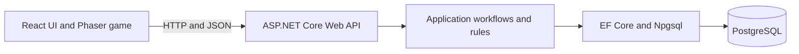

# Architecture

## Purpose

Breakout is planned as a browser game backed by an ASP.NET Core Web API. The browser owns real-time gameplay; the API owns persistent data, identity, authorization, and application rules. The backend starts as a modular monolith so the application can evolve without the operational cost of distributed services.

## Current implementation

- `src/Breakout.Api` is an ASP.NET Core minimal API targeting .NET 10.
- The API exposes `GET /health` and an OpenAPI document in Development.
- `Data/AppDbContext.cs` is the EF Core context and is registered with dependency injection.
- Npgsql is configured as the EF Core provider for PostgreSQL.
- The connection string is read from `ConnectionStrings:DefaultConnection`.
- No game entities, migrations, database initialization, or database-backed endpoints exist yet. The health endpoint does not require the database to be available.

## Intended architecture

The frontend simulates the game locally and submits a completed result. The API validates the request and game-session state, then persists accepted data. Client-submitted scores are untrusted; basic validation does not prove a score was legitimately earned.

As features grow, keep clear responsibilities between HTTP handling, application workflows, domain rules, and persistence. Introduce separate projects or abstractions when they provide a useful boundary, rather than creating layers pre-emptively.

## Data access decision: EF Core with PostgreSQL

**Status:** Accepted for the project foundation.

**Decision:** Use Entity Framework Core for object-relational mapping, queries, and schema migrations, with PostgreSQL as the relational database and Npgsql as its EF Core provider.

**Why this fits the project:**

- Game sessions, results, users, and achievements have relational relationships and integrity requirements.
- PostgreSQL supports foreign keys, transactions, indexes, and the query patterns needed for history, statistics, and leaderboards.
- EF Core provides a familiar C# data-access model and migration workflow while allowing focused SQL when a query needs it.
- This stack is compatible with the project's .NET backend and gives the project a realistic, reproducible persistence story.

**Trade-offs:**

- PostgreSQL must be installed or run as a service for persistence work; it adds setup compared with an embedded database.
- EF Core migrations need to be reviewed and applied deliberately as the schema changes.
- The database schema and application model can diverge if changes are made outside the migration workflow.

**Alternatives considered:**

- SQLite would make local setup lighter, but PostgreSQL is the intended production-style relational database and avoids developing against a different database engine.
- Direct SQL would offer precise control but would require more manual mapping and schema-management work for this application's initial needs.
- A document database is not currently justified because the planned data has clear relationships and transactional constraints.

## Configuration and migrations

The checked-in `appsettings.json` contains a local-development connection string without a password. For environments requiring credentials or other values, override it through the `ConnectionStrings__DefaultConnection` environment variable or an appropriate secret store. Do not commit production credentials.

When persistence models are introduced, create EF Core migrations from the API project and review generated SQL and schema changes before applying them. Do not make application startup silently create or migrate a production database. Local database provisioning and migration commands should be documented alongside the feature that introduces the first persisted entity.

## Trust and security boundaries

- Treat all request data, including score submissions, as untrusted.
- Derive the player identity from authenticated server-side identity when accounts are added; do not trust a user ID supplied in the request body.
- Validate game-session state and prevent repeated completion before persisting a result.
- Use database constraints and transactions to protect important invariants.
- Keep secrets out of source control and use HTTPS in deployed environments.

## Planned evolution

1. Add game-session and result models, then create and apply the initial migration.
2. Implement session creation, result completion, and retrieval with focused application and API tests.
3. Add accounts, authorization, player history, and leaderboard queries when those milestones are reached.
4. Add Docker-based PostgreSQL development and deployment workflows when local setup is ready to be standardized.
